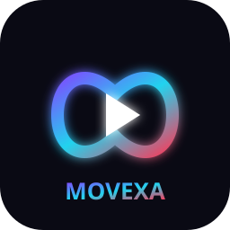

<div align="center">



# MOVEXA

**AI-Powered 2D Animation & Video Production Studio**

*Create Motion. Tell Stories.*


</div>

MOVEXA is a hybrid 2D animation desktop app — keyframe engine, cut-out
character rigs, procedural actions, deterministic MP4 rendering, and a
controlled AI instruction pipeline, in one workspace.

| | |
|---|---|
| 🎞 **Keyframes & playback** | integer-frame timeline, 6 easings, drift-free playback, camera tracks (pan / zoom / follow) |
| 🧍 **Cut-out animation** | parented character rigs with pivot joints; `walk`, `wave`, `jump`, `idle` actions sampled into real keyframes |
| 🎬 **Transitions** | crossfade, dip-to-black, dip-to-white — preview and export share one plan |
| 🖼 **Compositor** | layers, parenting, opacity, procedural shapes, text, image assets |
| 📤 **Export** | deterministic frame renderer → FFmpeg → MP4 (H.264 + AAC audio mix) |
| 🤖 **AI** | provider-adapter engine (`mock`, OpenAI, Anthropic, Gemini) — structured, validated scene generation, never raw generated code |
| 💬 **AI Agent** | editor chat dock: "add rect at 600,300", "spin 0-60", "outline: …", "generate a scene: …" — offline via the deterministic Mock provider |
| 🔊 **Audio** | clip import, multi-track mixing, lip-sync envelopes, SRT subtitles |

## Quick start

```pwsh
git clone https://github.com/bimnova001/MOVEXA.git
cd MOVEXA
pip install -r requirements.txt
python main.py
```

Verify ffmpeg is on PATH for MP4 export:

```pwsh
ffmpeg -version
```

```pwsh
# GUI-free test suite
python -m pytest tests

# headless render smoke test (writes scripts/_smoke_out/)
python scripts/smoke_gui.py
```

## Workflow in 30 seconds

1. **Create a project** on the dashboard — scenes live at
   `project/movexa/projects/<name>`.
2. **Import assets** (PNG images; WAV audio) in the asset browser.
3. **Build the scene** — shapes, text, or the *Add character rig* button.
4. **Animate** — set keys at the playhead, or pick an action in the
   Properties ▸ Actions panel and apply it.
5. **Add a scene transition** (Properties ▸ Scene ▸ Transition) and audition
   it by scrubbing to the scene's last frames.
6. **Export MP4** — rendering is frame-indexed, never wall-clocked.

## Architecture

Modular top-level packages; the GUI never computes animation:

```
main.py          launcher
core/            event bus (pub/sub)
project/         schema v1.0 (lossless), project manager, asset manager
engine/          scene graph, keyframes, tracks, playback, rigs,
                 actions, transitions, renderer, FFmpeg export
app/             AppController + panels + canvas (thin widgets)
ai/              provider adapters, prompt templates, validators, settings
audio/           clips, subtitles, mixer, lip sync, SRT
tests/           163 GUI-free tests
scripts/         headless GUI smoke test
```

Two load-bearing rules:

- **Determinism** — `render_frame(project, global_frame)` produces identical
  bytes for identical inputs. Preview speed never leaks into exports.
- **Lossless schema** — unknown fields survive load→save via `extras`, so a
  project written by a newer build still opens cleanly in an older one.

## Documentation

Engineering docs live in [`docs/`](docs/README.md):

- [Architecture overview](docs/architecture.md)
- [Rendering & export](docs/rendering.md)
- [AI providers](docs/ai.md)
- [Audio & subtitles](docs/audio.md)
- [Development guide](docs/development.md)

Specs at the repo root: [`INFO.md`](info.md) ·
[`ARCHITECTURE.md`](ARCHITECTURE.md)

## Progress

| Priority | Scope | Status |
|---|---|---|
| 1 — Foundation | event bus, schema, projects, assets, scene graph, GUI | ✅ |
| 2 — Animation Core | keyframes, evaluation, playback, camera, transport | ✅ |
| 3 — Hybrid Engine | rigs + pivots, actions, camera follow, transitions | ✅ |
| 4 — Rendering | deterministic renderer, MP4 export | ✅ |
| 5 — AI | provider adapters, prompts, scene generation | ✅ |
| 6 — Audio | clips, subtitles, lip sync, mixing, MP4 muxing | ✅ |
| 7 — Desktop polish | loading checks, editor-home menu, undo/redo, command palette, toasts | ✅ |

## Rules of the road

1. GUI never computes animation; the engine does.
2. Integer frames are the timing unit (30 fps ⇒ frame 0, 30, 60…).
3. Renderer is deterministic; preview speed must not affect exports.
4. AI output is validated structured data before it reaches the engine —
   never raw code.
5. No placeholder buttons: a feature listed as done must really work.

---

<div align="center">
<sub>Made with ❤️ and a lot of keyframes</sub>
</div>
