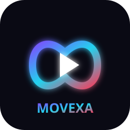

# MOVEXA Documentation



MOVEXA is an AI-assisted hybrid 2D animation desktop application built with
Python and PySide6. This folder collects the engineering documentation that
supports `INFO.md` and `ARCHITECTURE.md` at the repository root.

## Contents

- [Architecture overview](architecture.md)
- [Rendering and export](rendering.md)
- [AI providers](ai.md)
- [Audio and subtitles](audio.md)
- [Development guide](development.md)

## Status

- Priority 1 — Foundation: complete
- Priority 2 — Animation Core: complete
- Priority 3 — Hybrid Engine: complete
- Priority 4 — Rendering: complete
- Priority 5 — AI: complete
- Priority 6 — Audio: complete

## Quick start

```pwsh
pip install -r requirements.txt
python main.py
```

Run the test suite:

```pwsh
python -m pytest tests
python scripts/smoke_gui.py
```
